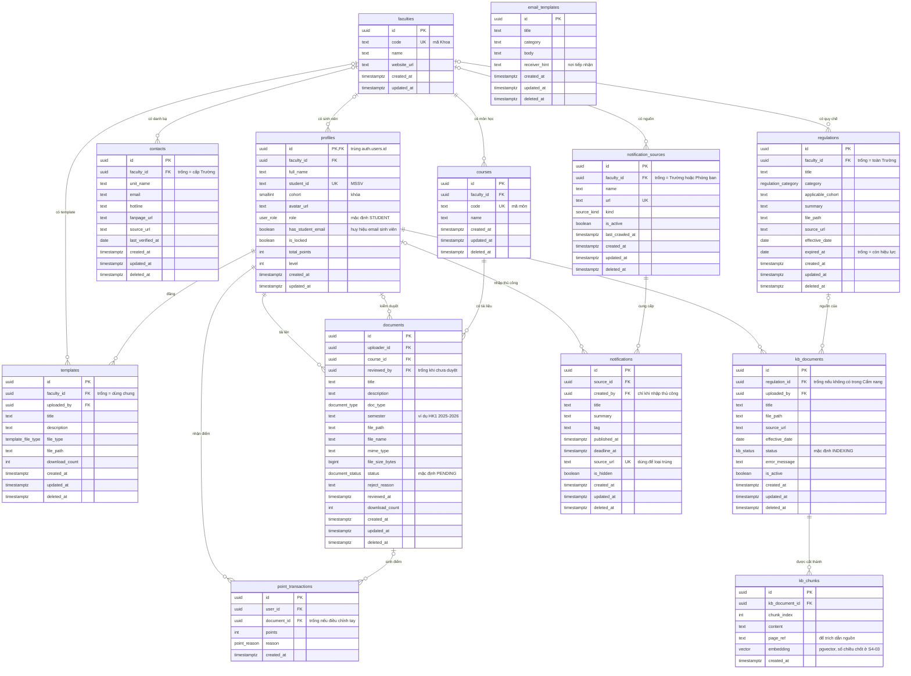

# ERD HCMUS-HUB

> **Trạng thái:** bản nháp cho task **S0-04** · Người phụ trách: Đoàn Thế Phùng · Người review: Trịnh Đỗ Minh Huy
>
> Tài liệu gồm: sơ đồ, danh sách quan hệ, từ điển dữ liệu từng bảng, kiểu enum, ràng buộc/chỉ mục đề xuất và quyền truy cập dự kiến. Đây vẫn là thiết kế **sơ bộ**: khi làm S1-02, S2-02, S3-02, S4-03 nhóm sẽ viết thành file migration trong `db/migrations/` và được phép chỉnh lại, **sửa luôn file này trong cùng Pull Request**.

## 1. Quy ước chung

- Tên bảng, cột: `snake_case`; tên bảng số nhiều (mục 11.1 của `CODING_CONVENTION.md`).
- Khóa chính `id` kiểu `uuid`, mặc định `gen_random_uuid()`. Riêng `profiles.id` trùng `auth.users.id` của Supabase Auth.
- Khóa ngoại tên `<tên bảng số ít>_id`; ngoại lệ có nghĩa riêng: `uploader_id`, `reviewed_by`, `uploaded_by`, `created_by`.
- Mọi bảng có `created_at` và `updated_at` (`timestamptz`, `NOT NULL`, mặc định `now()`), **trừ hai bảng chỉ ghi thêm, không sửa**: `point_transactions` (sổ điểm) và `kb_chunks` (đoạn văn bản; đánh chỉ mục lại = xóa rồi thêm), hai bảng này chỉ có `created_at`.
- Bảng có thể ẩn/xóa có thêm `deleted_at` (`timestamptz`, trống = còn dùng). Truy vấn mặc định lọc `deleted_at IS NULL`.
- Chuỗi dùng kiểu `text`. Ràng buộc khai báo ngay trong database: `NOT NULL`, `UNIQUE`, `CHECK`, khóa ngoại.
- Email và mật khẩu **không** nằm trong `profiles`; chúng ở `auth.users` do Supabase Auth quản lý.

## 2. Sơ đồ

Sơ đồ viết bằng Mermaid nên GitHub hiển thị trực tiếp; sửa sơ đồ bằng Pull Request như sửa code.

## 3. Danh sách quan hệ

Hành vi khi xóa (`ON DELETE`): hệ thống dùng **xóa mềm** nên hầu hết là `RESTRICT` (không cho xóa thật nếu còn dữ liệu con). Không dùng `SET NULL` cho `faculty_id` vì làm dữ liệu của một Khoa vô tình thành dữ liệu cấp Trường.

| Cha (1) | Con (n) | Khóa ngoại | Bắt buộc? | `ON DELETE` | Ý nghĩa |
|---|---|---|---|---|---|
| `auth.users` | `profiles` | `profiles.id` | Có (1–1) | `CASCADE` | Mỗi tài khoản đăng nhập có một hồ sơ |
| `faculties` | `profiles` | `faculty_id` | Không | `RESTRICT` | Khoa của sinh viên |
| `faculties` | `contacts` | `faculty_id` | Không | `RESTRICT` | Trống = đơn vị cấp Trường |
| `faculties` | `regulations` | `faculty_id` | Không | `RESTRICT` | Trống = quy chế toàn Trường |
| `faculties` | `notification_sources` | `faculty_id` | Không | `RESTRICT` | Trống = nguồn của Trường hoặc Phòng ban |
| `faculties` | `courses` | `faculty_id` | Có | `RESTRICT` | Môn học thuộc Khoa |
| `faculties` | `templates` | `faculty_id` | Không | `RESTRICT` | Trống = template dùng chung |
| `profiles` | `documents` | `uploader_id` | Có | `RESTRICT` | Người tải lên |
| `profiles` | `documents` | `reviewed_by` | Không | `RESTRICT` | Người duyệt/từ chối gần nhất |
| `profiles` | `point_transactions` | `user_id` | Có | `RESTRICT` | Người nhận điểm |
| `profiles` | `templates` | `uploaded_by` | Có | `RESTRICT` | Người đăng template |
| `profiles` | `kb_documents` | `uploaded_by` | Có | `RESTRICT` | Admin tải văn bản |
| `profiles` | `notifications` | `created_by` | Không | `RESTRICT` | Người nhập thủ công |
| `courses` | `documents` | `course_id` | Có | `RESTRICT` | Tài liệu thuộc môn |
| `documents` | `point_transactions` | `document_id` | Không | `RESTRICT` | Tài liệu sinh ra điểm |
| `notification_sources` | `notifications` | `source_id` | Có | `RESTRICT` | Nguồn của thông báo |
| `regulations` | `kb_documents` | `regulation_id` | Không | `RESTRICT` | Văn bản AI lấy từ quy chế nào |
| `kb_documents` | `kb_chunks` | `kb_document_id` | Có | `CASCADE` | Xóa văn bản thì xóa luôn các đoạn |

`email_templates` là bảng độc lập, không có khóa ngoại.

## 4. Từ điển dữ liệu

Cột "Ràng buộc": `PK` khóa chính · `FK` khóa ngoại · `NN` `NOT NULL` · `UQ` duy nhất.

### 4.1 `faculties` — Khoa

| Cột | Kiểu | Ràng buộc | Ghi chú |
|---|---|---|---|
| `id` | `uuid` | PK | |
| `code` | `text` | NN, UQ | Mã Khoa |
| `name` | `text` | NN | Tên Khoa |
| `website_url` | `text` | | Trang chính thức của Khoa |
| `created_at`, `updated_at` | `timestamptz` | NN | |

### 4.2 `profiles` — Hồ sơ người dùng

| Cột | Kiểu | Ràng buộc | Ghi chú |
|---|---|---|---|
| `id` | `uuid` | PK, FK → `auth.users.id` | |
| `faculty_id` | `uuid` | FK → `faculties.id` | Người dùng tự do có thể để trống |
| `full_name` | `text` | NN | |
| `student_id` | `text` | UQ | MSSV; trống với người dùng tự do |
| `cohort` | `smallint` | | Khóa học |
| `avatar_url` | `text` | | |
| `role` | `user_role` | NN, mặc định `STUDENT` | **Người dùng không được tự sửa** |
| `has_student_email` | `boolean` | NN, mặc định `false` | Đặt `true` khi email thuộc `@student.hcmus.edu.vn` |
| `is_locked` | `boolean` | NN, mặc định `false` | Khóa tài khoản vi phạm |
| `total_points` | `int` | NN, mặc định `0`, `CHECK (total_points >= 0)` | Số lưu sẵn, cập nhật cùng `point_transactions` |
| `level` | `int` | NN, mặc định `1`, `CHECK (level >= 1)` | Suy ra từ điểm |
| `created_at`, `updated_at` | `timestamptz` | NN | |

### 4.3 `contacts` — Danh bạ học vụ

| Cột | Kiểu | Ràng buộc | Ghi chú |
|---|---|---|---|
| `id` | `uuid` | PK | |
| `faculty_id` | `uuid` | FK | Trống = cấp Trường (Phòng Đào tạo, Phòng CTSV...) |
| `unit_name` | `text` | NN | |
| `email`, `hotline`, `fanpage_url` | `text` | | `CHECK`: ít nhất một trong ba cột có giá trị |
| `source_url` | `text` | NN | Nguồn chính thức của thông tin |
| `last_verified_at` | `date` | | Lần cuối nhóm đối chiếu với nguồn |
| `created_at`, `updated_at`, `deleted_at` | `timestamptz` | NN, NN, trống được | |

### 4.4 `regulations` — Cẩm nang quy chế

| Cột | Kiểu | Ràng buộc | Ghi chú |
|---|---|---|---|
| `id` | `uuid` | PK | |
| `faculty_id` | `uuid` | FK | Trống = toàn Trường |
| `title` | `text` | NN | |
| `category` | `regulation_category` | NN | |
| `applicable_cohort` | `text` | | Khóa/ngành áp dụng, ví dụ "Khóa 2024 trở đi" |
| `summary` | `text` | | Tóm lược |
| `file_path` | `text` | | Bản PDF (cũng dùng lại cho Knowledge Base ở Sprint 4) |
| `source_url` | `text` | NN | Link văn bản chính thức |
| `effective_date` | `date` | | Ngày có hiệu lực |
| `expired_at` | `date` | `CHECK (expired_at >= effective_date)` | Trống = còn hiệu lực; tránh dùng quy định cũ |
| `created_at`, `updated_at`, `deleted_at` | `timestamptz` | | |

### 4.5 `email_templates` — Mẫu email học vụ

| Cột | Kiểu | Ràng buộc | Ghi chú |
|---|---|---|---|
| `id` | `uuid` | PK | |
| `title` | `text` | NN | Ví dụ "Xin hoãn thi" |
| `category` | `text` | NN | Khiếu nại điểm, hoãn thi, nộp chứng chỉ... |
| `body` | `text` | NN | Nội dung mẫu, dùng cho nút sao chép |
| `receiver_hint` | `text` | | Hướng dẫn nơi tiếp nhận |
| `created_at`, `updated_at`, `deleted_at` | `timestamptz` | | |

### 4.6 `notification_sources` — Nguồn thu thập thông báo

| Cột | Kiểu | Ràng buộc | Ghi chú |
|---|---|---|---|
| `id` | `uuid` | PK | |
| `faculty_id` | `uuid` | FK | Trống = Trường hoặc Phòng ban |
| `name` | `text` | NN | Tên đơn vị đăng, hiển thị ở "Đơn vị đăng" |
| `url` | `text` | UQ | Trang nguồn; trống nếu `kind = MANUAL` |
| `kind` | `source_kind` | NN | `AUTO` thu thập tự động, `MANUAL` nhập tay |
| `is_active` | `boolean` | NN, mặc định `true` | Tắt nguồn mà không xóa |
| `last_crawled_at` | `timestamptz` | | Lần thu thập gần nhất |
| `created_at`, `updated_at`, `deleted_at` | `timestamptz` | | |

### 4.7 `notifications` — Thông báo

| Cột | Kiểu | Ràng buộc | Ghi chú |
|---|---|---|---|
| `id` | `uuid` | PK | |
| `source_id` | `uuid` | NN, FK | Đơn vị đăng |
| `created_by` | `uuid` | FK → `profiles.id` | Chỉ có khi nhập thủ công |
| `title` | `text` | NN | |
| `summary` | `text` | | **Chỉ lưu tóm lược**, không sao chép toàn văn |
| `tag` | `text` | NN | |
| `published_at` | `timestamptz` | NN | Ngày đăng |
| `deadline_at` | `timestamptz` | | Trống = không có hạn |
| `source_url` | `text` | UQ | Liên kết "Xem bản gốc"; dùng loại trùng. Có thể trống với thông báo nhập tay |
| `is_hidden` | `boolean` | NN, mặc định `false` | Moderator ẩn thông báo lỗi |
| `created_at`, `updated_at`, `deleted_at` | `timestamptz` | | |

Nhãn "Sắp hết hạn"/"Đã hết hạn" **không lưu**, tính từ `deadline_at` lúc truy vấn theo giờ Việt Nam.

### 4.8 `courses` — Môn học

| Cột | Kiểu | Ràng buộc | Ghi chú |
|---|---|---|---|
| `id` | `uuid` | PK | |
| `faculty_id` | `uuid` | NN, FK | |
| `code` | `text` | NN, UQ | Mã môn |
| `name` | `text` | NN | |
| `created_at`, `updated_at`, `deleted_at` | `timestamptz` | | |

### 4.9 `documents` — Tài liệu học tập

| Cột | Kiểu | Ràng buộc | Ghi chú |
|---|---|---|---|
| `id` | `uuid` | PK | |
| `uploader_id` | `uuid` | NN, FK → `profiles.id` | |
| `course_id` | `uuid` | NN, FK | |
| `reviewed_by` | `uuid` | FK → `profiles.id` | Trống khi chưa duyệt |
| `title` | `text` | NN | |
| `description` | `text` | | |
| `doc_type` | `document_type` | NN | Loại tài liệu |
| `semester` | `text` | NN | Học kỳ để lọc |
| `file_path` | `text` | NN | Đường dẫn trong Storage, chưa gắn với Cloudinary hay Supabase (S3-03) |
| `file_name`, `mime_type` | `text` | | Tên gốc, loại tệp |
| `file_size_bytes` | `bigint` | `CHECK (file_size_bytes > 0)` | |
| `status` | `document_status` | NN, mặc định `PENDING` | Chỉ `APPROVED` mới công khai |
| `reject_reason` | `text` | | `CHECK`: bắt buộc khi `status = 'REJECTED'` |
| `reviewed_at` | `timestamptz` | | |
| `download_count` | `int` | NN, mặc định `0`, `CHECK (>= 0)` | |
| `created_at`, `updated_at`, `deleted_at` | `timestamptz` | | |

### 4.10 `templates` — Kho template báo cáo/slide

| Cột | Kiểu | Ràng buộc | Ghi chú |
|---|---|---|---|
| `id` | `uuid` | PK | |
| `faculty_id` | `uuid` | FK | Trống = dùng chung toàn Trường |
| `uploaded_by` | `uuid` | NN, FK → `profiles.id` | |
| `title` | `text` | NN | |
| `description` | `text` | | |
| `file_type` | `template_file_type` | NN | |
| `file_path` | `text` | NN | |
| `download_count` | `int` | NN, mặc định `0` | |
| `created_at`, `updated_at`, `deleted_at` | `timestamptz` | | |

### 4.11 `point_transactions` — Sổ điểm (chỉ ghi thêm)

| Cột | Kiểu | Ràng buộc | Ghi chú |
|---|---|---|---|
| `id` | `uuid` | PK | |
| `user_id` | `uuid` | NN, FK → `profiles.id` | |
| `document_id` | `uuid` | FK | Trống nếu điều chỉnh tay |
| `points` | `int` | NN, `CHECK (points <> 0)` | Số dương là cộng, số âm là thu hồi |
| `reason` | `point_reason` | NN | |
| `created_at` | `timestamptz` | NN | Không có `updated_at` vì không sửa dòng đã ghi |

Ràng buộc duy nhất `UNIQUE (document_id, reason)` đảm bảo **một tài liệu chỉ được cộng điểm một lần** cho cùng một lý do, kể cả khi Moderator bấm duyệt lại.

### 4.12 `kb_documents` — Văn bản trong Knowledge Base

| Cột | Kiểu | Ràng buộc | Ghi chú |
|---|---|---|---|
| `id` | `uuid` | PK | |
| `regulation_id` | `uuid` | FK | Trống nếu văn bản không có trong Cẩm nang |
| `uploaded_by` | `uuid` | NN, FK → `profiles.id` | Chỉ Admin |
| `title` | `text` | NN | Dùng khi trích dẫn nguồn |
| `file_path` | `text` | NN | |
| `source_url` | `text` | | Link văn bản chính thức |
| `effective_date` | `date` | | Để AI không trả lời theo quy định đã hết hiệu lực |
| `status` | `kb_status` | NN, mặc định `INDEXING` | |
| `error_message` | `text` | | Lý do khi `FAILED` |
| `is_active` | `boolean` | NN, mặc định `true` | Tắt để AI ngừng dùng văn bản |
| `created_at`, `updated_at`, `deleted_at` | `timestamptz` | | |

### 4.13 `kb_chunks` — Đoạn văn bản và vector

| Cột | Kiểu | Ràng buộc | Ghi chú |
|---|---|---|---|
| `id` | `uuid` | PK | |
| `kb_document_id` | `uuid` | NN, FK | `ON DELETE CASCADE` |
| `chunk_index` | `int` | NN | Thứ tự đoạn; `UNIQUE (kb_document_id, chunk_index)` |
| `content` | `text` | NN | Nội dung đoạn |
| `page_ref` | `text` | | Trang/điều khoản để trích dẫn |
| `embedding` | `vector(N)` | NN | Số chiều `N` theo mô hình embedding, chốt ở S4-03 |
| `created_at` | `timestamptz` | NN | |

## 5. Kiểu enum

| Kiểu | Giá trị |
|---|---|
| `user_role` | `STUDENT`, `MODERATOR`, `ADMIN` |
| `regulation_category` | `REGISTRATION` (đăng ký học phần), `ACADEMIC_WARNING` (cảnh báo học vụ), `ENGLISH_STANDARD` (chuẩn Tiếng Anh), `OTHER` |
| `source_kind` | `AUTO`, `MANUAL` |
| `document_type` | `EXAM` (đề thi), `SLIDE`, `TEXTBOOK` (giáo trình), `OTHER` |
| `document_status` | `PENDING`, `APPROVED`, `REJECTED` |
| `template_file_type` | `WORD`, `POWERPOINT`, `LATEX`, `OTHER` |
| `point_reason` | `DOCUMENT_APPROVED`, `ADJUSTMENT` |
| `kb_status` | `INDEXING`, `READY`, `FAILED` |

Luồng trạng thái tài liệu: `PENDING → APPROVED` hoặc `PENDING → REJECTED` (kèm lý do). Chuyển sai luồng thì backend báo lỗi.

## 6. Ràng buộc và chỉ mục đề xuất

| Mục tiêu | Đề xuất |
|---|---|
| Không cộng điểm trùng | `UNIQUE (document_id, reason)` trên `point_transactions` |
| Loại thông báo trùng | `UNIQUE (source_url)` trên `notifications` |
| Tìm tài liệu < 1 giây | Chỉ mục tìm kiếm toàn văn (GIN) trên `documents.title`, `courses.code`/`courses.name`; chỉ mục `(status, course_id)`. Cần cân nhắc tìm không dấu tiếng Việt (ví dụ extension `unaccent`) |
| Lọc và sắp xếp thông báo | Chỉ mục `(published_at DESC)` và `(deadline_at)` trên `notifications` |
| Hàng đợi kiểm duyệt | Chỉ mục `(status, created_at)` trên `documents` |
| Bảng xếp hạng | Chỉ mục `(total_points DESC)` trên `profiles` |
| Tìm vector | Chỉ mục vector (ví dụ HNSW) trên `kb_chunks.embedding`, chốt ở S4-03 |

## 7. Quyền truy cập dự kiến (RLS)

Bật Row Level Security cho mọi bảng. Phần thực thi chi tiết viết trong migration; bảng này để người review soát ý định.

| Bảng | Ai đọc được | Ai ghi được |
|---|---|---|
| `faculties`, `contacts`, `regulations`, `email_templates`, `templates`, `courses` | Mọi người dùng (kể cả chưa đăng nhập, nếu nhóm đồng ý công khai) | Admin |
| `notifications`, `notification_sources` | Mọi người (không gồm thông báo `is_hidden`) | Admin, Moderator; bộ thu thập chạy bằng khóa backend |
| `profiles` | Chủ hồ sơ; thông tin công khai rút gọn (tên, điểm, level) cho bảng xếp hạng | Chủ hồ sơ sửa thông tin cá nhân; **không** được sửa `role`, `is_locked`, `total_points`, `level`. Admin đổi `role` |
| `documents` | Mọi người xem tài liệu `APPROVED`; chủ tài liệu xem tài liệu của mình; Moderator/Admin xem tất cả | Sinh viên đã đăng nhập thêm tài liệu `PENDING`; chỉ Moderator/Admin đổi `status` |
| `point_transactions` | Chủ sổ điểm | Chỉ backend (khóa `service`) |
| `kb_documents`, `kb_chunks` | Backend (để AI truy hồi); Admin xem danh sách | Admin tải lên; backend ghi chunk |

## 8. Kiểm tra bao phủ yêu cầu

| Yêu cầu | Đáp ứng bằng |
|---|---|
| Gắn huy hiệu khi dùng email sinh viên HCMUS | `profiles.has_student_email` |
| Lọc danh bạ, quy chế theo Khoa | `contacts.faculty_id`, `regulations.faculty_id` |
| Quy chế theo khóa/ngành, tránh dùng quy định cũ | `regulations.applicable_cohort`, `effective_date`, `expired_at` |
| Mẫu email kèm hướng dẫn nơi tiếp nhận | `email_templates.body`, `receiver_hint` |
| Thông báo có Tag, Ngày đăng, Tiêu đề, Đơn vị đăng, Deadline | `notifications.tag/published_at/title/source_id/deadline_at` |
| Nhãn Sắp hết hạn / Đã hết hạn | Tính từ `notifications.deadline_at` |
| Loại trùng, nút "Xem bản gốc" | `notifications.source_url` duy nhất |
| Thêm/sửa/tắt nguồn, ẩn thông báo lỗi, nhập tay | `notification_sources.is_active/kind`, `notifications.is_hidden/created_by` |
| Đổi vai trò, khóa tài khoản | `profiles.role`, `profiles.is_locked` |
| Lọc tài liệu theo Khoa, Học kỳ, Loại | `documents.course_id` → `courses.faculty_id`, `semester`, `doc_type` |
| Duyệt hoặc từ chối kèm lý do | `documents.status/reject_reason/reviewed_by/reviewed_at` |
| Tích điểm khi được duyệt, không cộng trùng | `point_transactions` + `UNIQUE (document_id, reason)` |
| Bảng xếp hạng, level | `profiles.total_points`, `profiles.level` |
| Kho template Word, PowerPoint, LaTeX | `templates.file_type` |
| AI trả lời kèm trích dẫn nguồn | `kb_chunks.page_ref` → `kb_documents.title/source_url` |
| Admin tải PDF quy chế mới vào Knowledge Base | `kb_documents` → `kb_chunks` |

## 9. Quyết định thiết kế đã chọn (cần Huy và nhóm xác nhận)

1. **Một kiểu `id` cho mọi bảng: `uuid`.** `profiles.id` buộc là `uuid`; dùng `uuid` cho tất cả giúp frontend và API chỉ có một kiểu id (chuỗi).
2. **Vai trò là một cột của `profiles`** (3 giá trị cố định, mỗi người một vai trò), chưa có bảng `roles`. File kế hoạch ghi S2-02 làm bảng "vai trò", cần hỏi lại xem nhóm hiểu thế nào.
3. **`notifications.tag` là một cột chữ**, mỗi thông báo một Tag; chưa tạo bảng Tag nhiều–nhiều.
4. **`regulations` ghi khóa/ngành bằng cột `applicable_cohort`**, chưa tạo bảng `programs` (ngành).
5. **`regulations` và `kb_documents` tách riêng**, nối bằng `kb_documents.regulation_id` (có thể trống). Cẩm nang là nội dung để đọc; Knowledge Base có vòng đời khác (đánh chỉ mục, bật/tắt).
6. **Điểm lấy từ `point_transactions`; `profiles.total_points` là số lưu sẵn** để xếp hạng nhanh. Server cập nhật cả hai trong cùng một transaction.
7. **Lưu `file_path`**, không gắn cứng URL, vì chưa chốt Cloudinary hay Supabase Storage (S3-03).
8. **`notifications.source_url` cho phép trống** để nhập tay được thông báo không có liên kết; khi đó khóa duy nhất không áp dụng để loại trùng.

## 10. Chưa vẽ, cần cả nhóm quyết định

| Hạng mục | Vì sao chưa vẽ |
|---|---|
| Lịch sử trò chuyện với chatbot (`chat_sessions`, `chat_messages`) | SRS không yêu cầu lưu; câu hỏi là dữ liệu cá nhân, cần cân nhắc quyền riêng tư |
| Phần thưởng đổi điểm (gói màu giao diện, khung Avatar) | Mô tả bài toán có nhắc, nhưng danh sách chức năng chỉ yêu cầu điểm, level, bảng xếp hạng |
| Bảng cấu hình `levels` (mốc điểm từng cấp) | Có thể là hằng số trong code ở bản đầu |
| Nhật ký thu thập (`crawl_runs`) | Chỉ cần khi gỡ lỗi bộ thu thập ở S2-03 |
| Lịch sử kiểm duyệt (`moderation_logs`) | `documents` mới ghi lần duyệt gần nhất |
| Báo cáo vi phạm tài liệu | SRS chưa có |