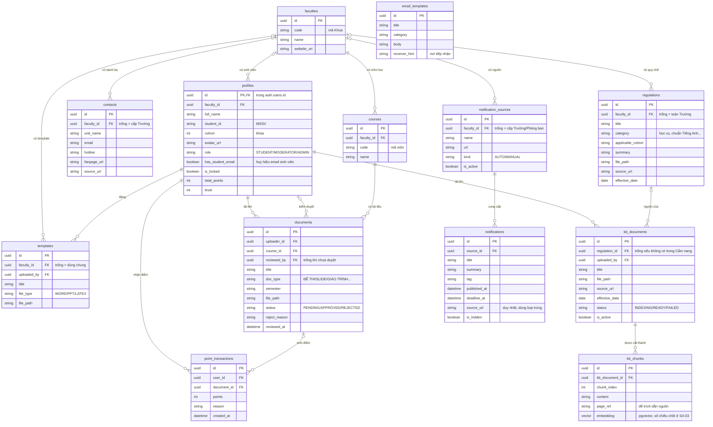

# Preview-Markdown
# ERD sơ bộ — HCMUS-HUB

> **Trạng thái:** bản nháp cho task **S0-04** (14–15/10/2026) · Người phụ trách: Đoàn Thế Phùng · Người review: Trịnh Đỗ Minh Huy
>
> ERD **sơ bộ** chỉ chốt: có những bảng nào, quan hệ giữa chúng, khóa chính/khóa ngoại và vài cột quan trọng. Danh sách cột đầy đủ, kiểu dữ liệu và ràng buộc sẽ được thiết kế chi tiết theo từng Sprint (S1-02, S2-02, S3-02, S4-03) và viết thành file migration trong `db/migrations/`.

## 1. Sơ đồ

Sơ đồ viết bằng Mermaid nên GitHub hiển thị trực tiếp; sửa sơ đồ bằng Pull Request như sửa code.

Quy ước chung cho **mọi bảng** (không vẽ lại từng bảng cho đỡ rối): có `created_at`, `updated_at`; bảng dữ liệu có thể ẩn/xóa có thêm `deleted_at` (xóa mềm). Tên bảng/cột theo `snake_case`, tên bảng số nhiều (mục 11.1 của `CODING_CONVENTION.md`).

## 2. Các bảng và nhóm chức năng

| Bảng | Dùng cho | Nhóm | Sprint |
|---|---|---|---|
| `faculties` | Danh sách Khoa, để lọc theo Khoa | II | 1 |
| `profiles` | Hồ sơ, vai trò, điểm/level. Email và mật khẩu nằm ở Supabase Auth (`auth.users`) | I, VII | 1 |
| `contacts` | Danh bạ học vụ | II | 1 |
| `regulations` | Cẩm nang quy chế và chuẩn Tiếng Anh | II | 1 |
| `email_templates` | Kho mẫu email học vụ | II | 1 |
| `notification_sources` | Nguồn thu thập thông báo (thêm/sửa/tắt) | III, VII | 2 |
| `notifications` | Bảng tin thông báo | III | 2 |
| `courses` | Môn học, để lọc tài liệu | IV | 3 |
| `documents` | Tài liệu sinh viên tải lên và luồng kiểm duyệt | IV, V, VII | 3 |
| `templates` | Kho template báo cáo/slide chuẩn | IV | 2–3 |
| `point_transactions` | Lịch sử cộng điểm (một lần cho mỗi tài liệu được duyệt) | V | 3 |
| `kb_documents` | Văn bản quy chế trong Knowledge Base của AI | VI, VII | 4 |
| `kb_chunks` | Các đoạn đã cắt và vector embedding | VI | 4 |

## 3. Kiểm tra bao phủ yêu cầu

Mỗi yêu cầu trong SRS phải trả lời được từ ERD. Cột ghi cách ERD đáp ứng:

| Yêu cầu | Đáp ứng bằng |
|---|---|
| Gắn huy hiệu khi dùng email sinh viên HCMUS | `profiles.has_student_email` |
| Lọc danh bạ/quy chế theo Khoa | `contacts.faculty_id`, `regulations.faculty_id` |
| Mỗi thông báo có Tag, Ngày đăng, Tiêu đề, Đơn vị đăng, Deadline | `notifications.tag/published_at/title/source_id/deadline_at` |
| Loại thông báo trùng, nút "Xem bản gốc" | `notifications.source_url` duy nhất |
| Thêm/sửa/tắt nguồn thu thập; nhập thủ công | `notification_sources.is_active/kind` |
| Lọc tài liệu theo Khoa, Học kỳ, Loại | `documents.course_id` → `courses.faculty_id`, `semester`, `doc_type` |
| Duyệt hoặc từ chối kèm lý do | `documents.status/reject_reason/reviewed_by` |
| Tích điểm khi được duyệt, không cộng trùng | `point_transactions` (ràng buộc duy nhất theo `document_id` + `reason`) |
| Bảng xếp hạng | `profiles.total_points` |
| Đổi vai trò, khóa tài khoản | `profiles.role`, `profiles.is_locked` |
| AI trả lời kèm trích dẫn nguồn | `kb_chunks.page_ref` → `kb_documents.title/source_url` |
| Admin tải PDF quy chế mới | `kb_documents` → `kb_chunks` |

## 4. Quyết định thiết kế đã chọn (cần Huy và nhóm xác nhận)

1. **Một kiểu `id` cho mọi bảng: `uuid`.** `profiles.id` buộc phải là `uuid` vì trùng `auth.users.id` của Supabase. Dùng `uuid` cho tất cả giúp frontend và API chỉ có một kiểu id (chuỗi), không nhầm giữa số và chuỗi.
2. **Vai trò là một cột của `profiles`** (3 giá trị cố định, mỗi người một vai trò), chưa tạo bảng `roles` riêng.
3. **`notifications.tag` là một cột chữ** (mỗi thông báo một Tag), chưa tạo bảng Tag nhiều–nhiều.
4. **`regulations` ghi khóa/ngành áp dụng bằng cột `applicable_cohort`**, chưa tạo bảng `programs` (ngành).
5. **`regulations` và `kb_documents` là hai bảng riêng**, nối nhau bằng `kb_documents.regulation_id` (có thể trống). Cẩm nang là nội dung để đọc; Knowledge Base là dữ liệu cho AI, có vòng đời khác (đánh chỉ mục, bật/tắt).
6. **Điểm tính từ `point_transactions`, `profiles.total_points` là số lưu sẵn** để xếp hạng nhanh. Server cập nhật cả hai trong cùng một transaction.
7. **Lưu đường dẫn tệp bằng `file_path`** (không gắn cứng URL), vì chưa chốt dùng Cloudinary hay Supabase Storage (S3-03).

## 5. Chưa vẽ, cần cả nhóm quyết định

| Hạng mục | Vì sao chưa vẽ |
|---|---|
| Lịch sử trò chuyện với chatbot (`chat_sessions`, `chat_messages`) | SRS không yêu cầu lưu; lưu câu hỏi là dữ liệu cá nhân, cần cân nhắc quyền riêng tư |
| Phần thưởng đổi điểm (gói màu giao diện, khung Avatar) | Mô tả bài toán có nhắc, nhưng danh sách chức năng chỉ yêu cầu điểm, level, bảng xếp hạng |
| Bảng cấu hình `levels` (mốc điểm của từng cấp) | Có thể là hằng số trong code ở bản đầu |
| Nhật ký thu thập (`crawl_runs`) | Chỉ cần khi gỡ lỗi bộ thu thập ở S2-03 |
| Lịch sử kiểm duyệt (`moderation_logs`) | Hiện `documents` đã ghi người duyệt, lý do, thời điểm cho lần duyệt gần nhất |
| Báo cáo vi phạm tài liệu | SRS chưa có |